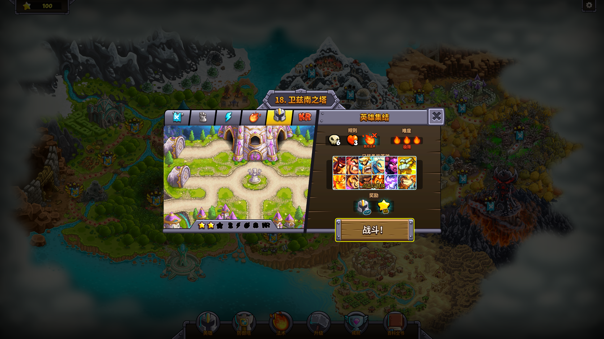
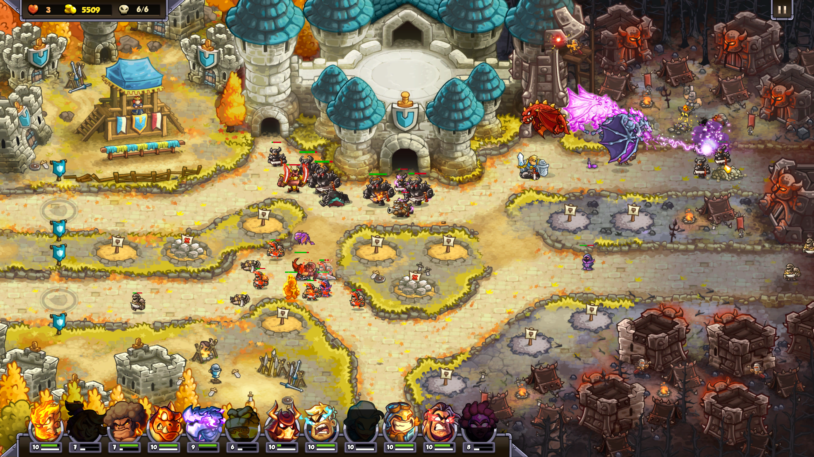

<div align="center">

# KR6 英雄集结 · 8 人 MOD

**Kingdom Rush Genesis「英雄集结」模式可上阵英雄 4 → 8 名**




</div>

---

## 功能

- 「英雄集结」模式英雄槽位 **4 → 8**
- 8 名英雄全部可上阵、可战斗
- 一键开关脚本：开启/关闭/自动备份，随时恢复原版

## 安装

1. 把整个 `mod` 文件夹和开关脚本放在任意位置
2. 双击 `英雄集结8人MOD开关.bat` → 输入 `1` 回车（开启）
3. 重启游戏，进入「英雄集结」模式即可

> 关闭：再次运行开关脚本输入 `2`，文件会自动备份并恢复原版。

## 版本要求

| 项目 | 版本 |
|------|------|
| 本 MOD 制作测试版本 | kr6-desktop-**1.00.072** |
| 其他版本 | 未测试，Lua 为版本绑定的字节码，跨版本可能报 `cannot load incompatible bytecode` |

## 工作原理

MOD 通过覆盖存档目录（`%APPDATA%\kingdom_rush_genesis\kr6\`）下的 4 个 Lua 脚本实现：
`kviews_screen_map_game.lua`、`game_gui.lua`、`window_level_select.lua`、`slot_template.lua`。
游戏加载时优先读取覆盖文件，删除覆盖文件即恢复原版。

## 目录结构

```
├─ mod/kr6/...                  覆盖文件本体
├─ 英雄集结8人MOD开关.bat        一键开关入口
├─ kr8mod_toggle.ps1            开关逻辑（PowerShell）
├─ 使用说明.txt                  给玩家的说明
├─ Nexus上传用/                  Nexus 发布文案
└─ 诊断工具/                     提取原版脚本比对、兼容性修复
```

## 常见问题

- **恢复原版**：运行开关脚本输入 `2`，或直接删除 `%APPDATA%\kingdom_rush_genesis\kr6` 文件夹
- **跨版本崩溃**：游戏更新后如报字节码错误，用 `诊断工具` 提取新版本原版脚本重新适配

## 声明

- 本 MOD 仅包含玩家自制的补丁文件，**不包含游戏本体**，使用前请确保你拥有《Kingdom Rush Genesis》合法副本
- 《Kingdom Rush Genesis》版权归 Ironhide Game Studio 所有
- 仅供学习交流使用，请勿用于商业用途
